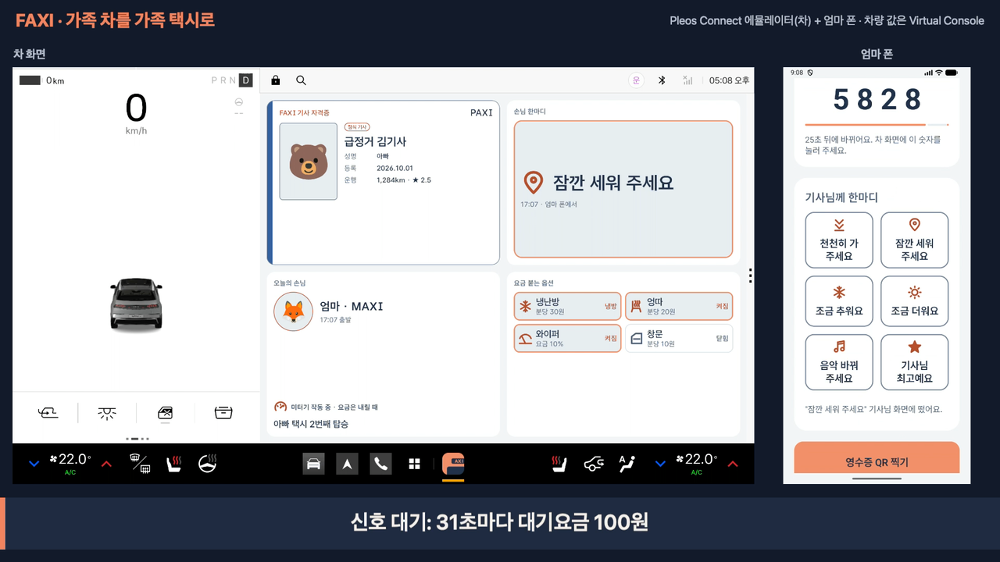
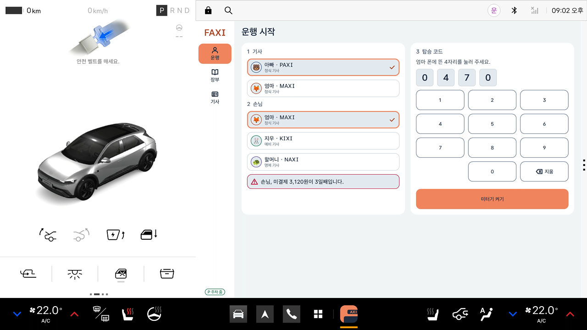
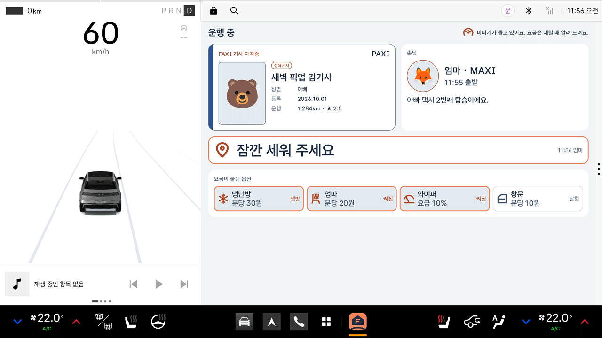
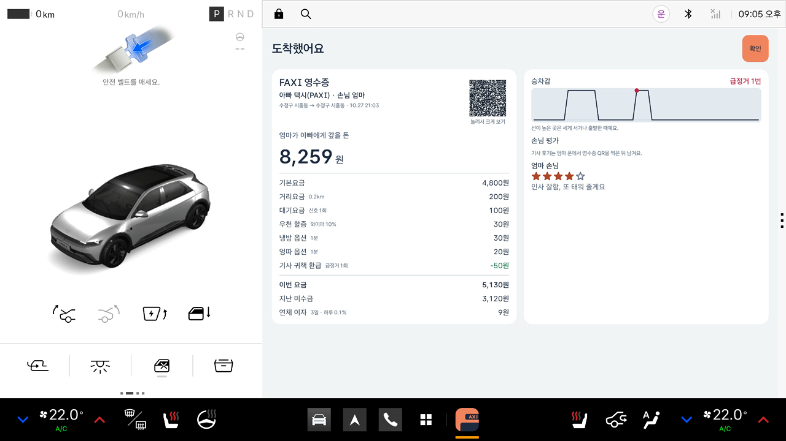
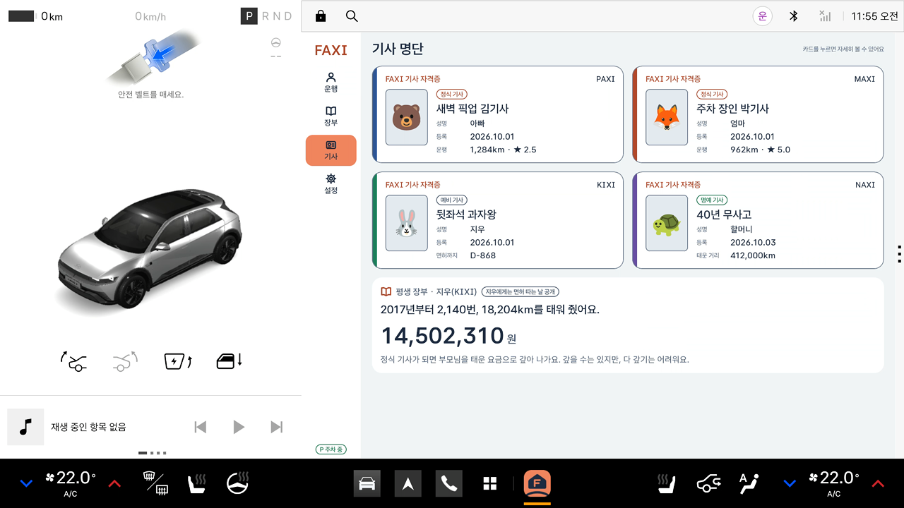
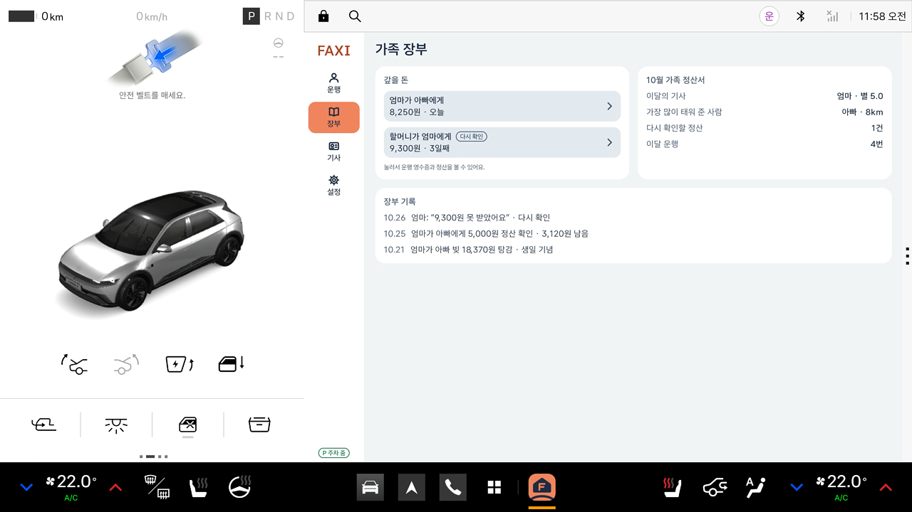
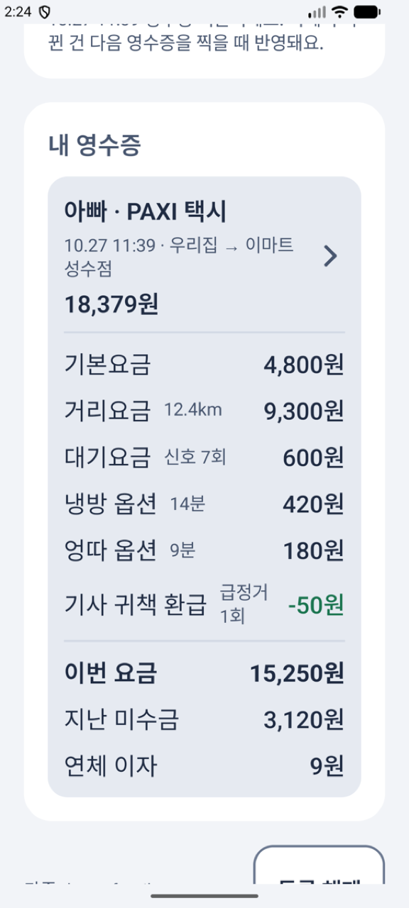

# FAXI — 가족 차를 가족 택시로

FAXI(Family + Taxi)는 운전하는 가족은 기사, 옆에 탄 가족은 손님이 되는 역할놀이 앱이다. 요금은 차량 데이터로 1원 단위까지 매기고, 앱은 가족 장부와 확인만 맡는다(실제 결제 없음).
현대자동차그룹 차량용 앱 개발 공모전(Pleos Connect) 출품작. 차 앱(Pleos Connect)과 가족 폰 앱 두 개로 이루어진다.

## 시연 영상

[](https://github.com/saejinpark/FAXI/releases/download/v1.0/FAXI-demo.mp4)

[시연 영상 받기(2분 30초, 1920×1080, 소리 없음, 18MB)](https://github.com/saejinpark/FAXI/releases/download/v1.0/FAXI-demo.mp4). Pleos Connect 에뮬레이터(왼쪽, 차)와 엄마 폰(오른쪽)을 같이 녹화했다. 탑승 인증부터 주행, 한마디, P 자동 하차, 영수증, 장부, 주행 중 잠금까지 차량 값은 Virtual Console로 넣었고 요금은 녹화 중 실제로 계산된 값이다. 차가 읽어 주는 음성은 자막으로 대신했다.

| 탑승 | 운행 중 | 도착 |
| --- | --- | --- |
|  |  |  |
| 기사·손님을 고르고 손님 폰의 4자리 코드로 미터기를 켠다. 밀린 돈이 있으면 차가 독촉한다. | 2×2 정지 화면: 기사 자격증, 손님 한마디, 손님, 요금 붙는 옵션. 금액은 보이지 않는다. | 기어 P에서 자동 하차. 영수증을 한 번에 공개하고 차가 요금을 읽는다. |

| 기사 명단 | 가족 장부 | 폰 앱 |
| --- | --- | --- |
|  |  |  |
| 가족마다 FAXI 기사 자격증. 아이는 예비 기사로 평생 장부가 쌓인다. | 누가 누구에게 얼마, 분쟁, 탕감, 월 정산서. 다시 태워 주면 빚이 상계된다. | 탑승 코드, 기사님께 한마디, 영수증 QR로 받은 내 영수증·정산 현황. |

## 요금은 전부 차량 데이터

| 항목 | 기준 | 차량 값 |
| --- | --- | --- |
| 기본요금 | 탑승 인증 즉시 4,800원 | 손님 폰 TOTP |
| 거리요금 | 132m당 100원 | 주행거리(Vehicle SDK Odometer) + 속도 적분 |
| 대기요금 | 정차 31초당 100원 | 속도(Car API PERF_VEHICLE_SPEED) |
| 심야 할증 | 22~4시 20% | 시계 |
| 냉난방 옵션 | 켜진 동안 분당 30원 | Vehicle SDK HVAC |
| 엉따 옵션 | 조수석 열선 분당 20원 | Vehicle SDK Seat |
| 우천 할증 | 와이퍼 작동 중 10% | Vehicle SDK Wiper |
| 환기 서비스 | 창문 연 동안 분당 10원 | Vehicle SDK Window |
| 경유지 추가 | 1곳 500원 | NaviHelper SDK |
| 기사 귀책 환급 | 급정거 1회 −50원 | 속도 변화(감속 3m/s² 이상) |

기획서 예시 영수증(기본 4,800 + 거리 9,300 + 대기 600 + 냉방 420 + 엉따 180 − 급정거 50 = 15,250원, 이월 3,120 + 이자 9 = 청구 18,379원)이 단위 테스트(`FareMeterTest`)로 그대로 나온다.

## Pleos SDK와 차량 API

| 무엇 | 쓰는 곳 | 권한(모두 읽기) |
| --- | --- | --- |
| Vehicle SDK 2.3.2 | 주행거리, 기어(하차 판정·주행 중 잠금), HVAC·시트·와이퍼·창문(옵션 요금) | `CAR_DRIVE` `CAR_CLIMATE` `CAR_SEATS` `CAR_WINDOWS` |
| TextToSpeech SDK 3.3.1 | 탑승 인사, 요금 안내, 독촉, 후기 낭독. ON_DEVICE(차 안 엔진) | `TTS_SERVICE` |
| NaviHelper SDK 3.0.5 | 출발지·도착지 이름, 경유지 요금 | `NAVI_ROUTE` |
| Android Car API | 속도(Pleos FAQ대로 클러스터와 같은 PERF_VEHICLE_SPEED), 주행 규제(CarUxRestrictions) | `CAR_SPEED` |

Pleos Connect 에뮬레이터(Pleos 이미지)와 Virtual Console로 탑승부터 자동 하차까지 실제 값으로 확인했다.

## 안전 원칙

- 운전자는 주행 중 아무것도 만지지 않는다. 탑승·영수증·후기·정산은 주차(P)에서만 열린다.
- 주행 중 화면은 정지 표시만: 애니메이션, 움직이는 미터기 숫자, 경과 시간 없음. 금액은 하차 때 한 번에 공개.
- 플랫폼 주행 규제(CarUxRestrictions)를 따른다. 운행 중이 아닐 때 주행 중이면 탑승·장부 화면을 닫는다.
- 손님 한마디는 정해진 문장만(자유 글 없음), 차는 주행 중에 말하지 않는다.
- 대비 4.5:1 이상, 터치 76dp 이상, 버튼 88dp, 680dp 이상에서 2열(Pleos 디자인 가이드).

## 서버 없이 차 안에서 끝난다

- **탑승 인증:** 가족마다 비밀 열쇠(초대 QR로 차 → 폰), 은행 OTP와 같은 TOTP 4자리. 인터넷 없음.
- **영수증:** 차 화면 QR(압축, 69칸 이하) → 폰이 찍어 저장.
- **손님 한마디:** 같은 Wi-Fi에서 폰 → 차 TCP 한 줄, 가족 열쇠로 HMAC 서명.
- **장부:** 차가 주인. 가족 데이터와 면허 정보는 차 밖으로 나가지 않는다(면허증 사진·번호는 받지 않는다).

## 구조

| 모듈 | 내용 |
| --- | --- |
| `:app` | 차 앱(Jetpack Compose). 탑승, 운행 중, 도착·영수증, 가족 장부, 기사 명단, 차량 값(`VehicleFeed`), 내비(`NaviFeed`), 운행 서비스 |
| `:phone` | 폰 앱. 가족 등록(초대 QR), 탑승 코드, 기사님께 한마디, 영수증 QR 찍기 |
| `:core` | 두 앱이 같이 쓰는 순수 Kotlin: 요금 엔진, TOTP, QR, 한마디 서명 |
| `:design` | 디자인 시스템 코드(색·글자·간격 토큰, 버튼, 선 아이콘, 앱 아이콘) |

## 빌드와 실행

```bash
./gradlew assembleDebug        # 네 모듈 빌드
./gradlew testDebugUnitTest    # 단위 테스트(요금, 장부, 인증, QR, 차량 값, 내비, 한마디)
tools/demo.sh                  # 에뮬레이터 두 대에 설치하고 시연 데이터로 시작
```

- 차: Android Studio의 Pleos Connect 에뮬레이터(시스템 이미지 `pleos_car_emulator`, API 34). 차량 값은 `adb forward tcp:8088 tcp:8088` 뒤 `http://127.0.0.1:8088/` Virtual Console로 바꾼다.
- 폰: Android 9(API 28) 이상. 앱에서 "시연 가족으로 등록"을 누르면 차 시연 데이터와 바로 맞물린다.
- 시연 순서: [`tools/DEMO.md`](tools/DEMO.md). 폰·폴드처럼 차량 값이 없는 기기에서는 기획서 예시 운행으로 하차 시연을 한다.

## 아직 남은 것

- 실제 차량에서의 확인(주행 중 화면 DO 선언, 핫스팟으로 폰 → 차 통신).
- 폰 카메라로 차 화면 QR 찍기는 실기기에서 확인 전(에뮬레이터는 스크린샷 해독·딥 링크로 확인).
- 승차감 그래프 모양은 시연 데이터(급정거 점 개수만 실제).
