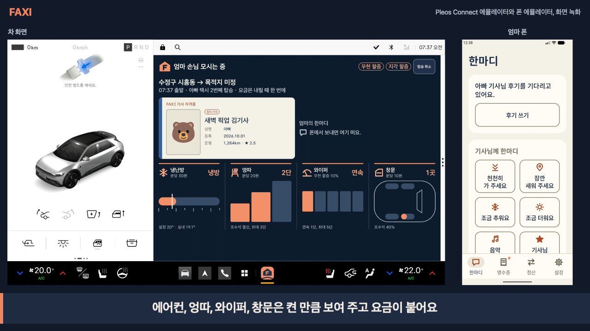
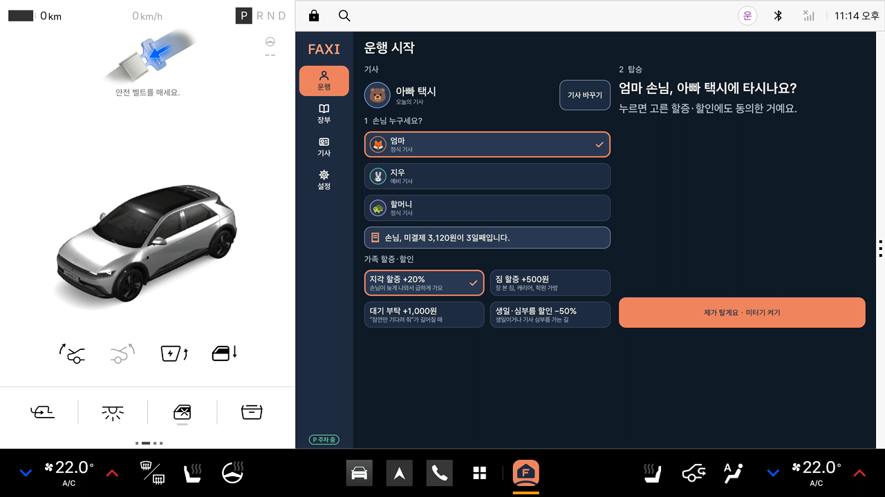
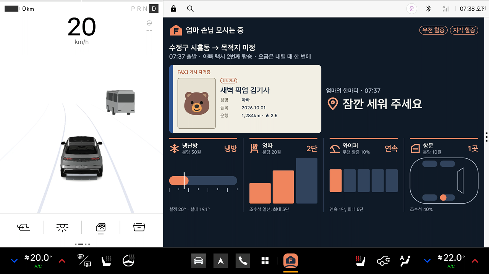
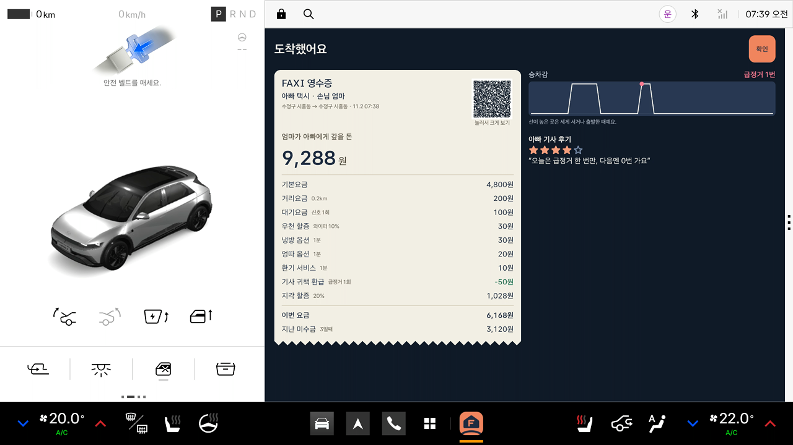
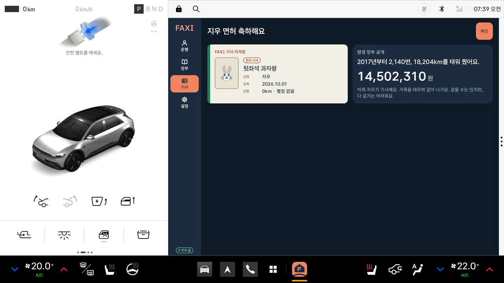
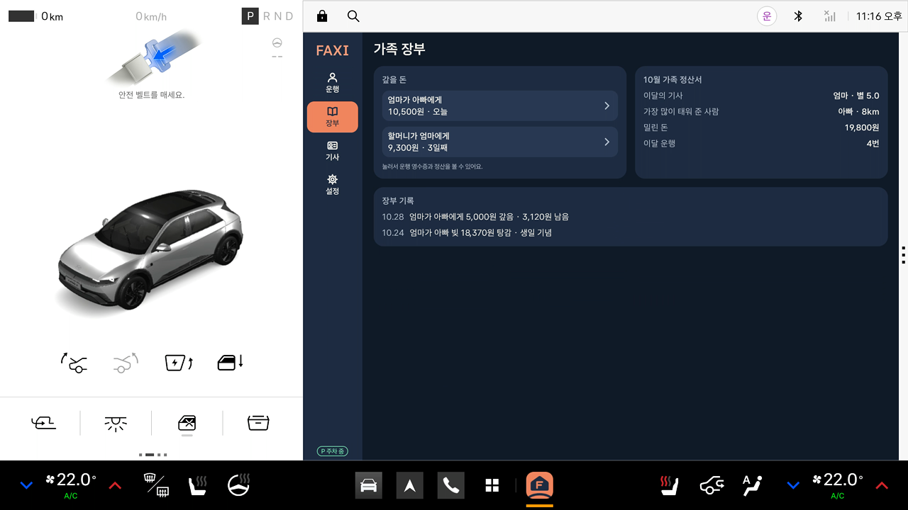
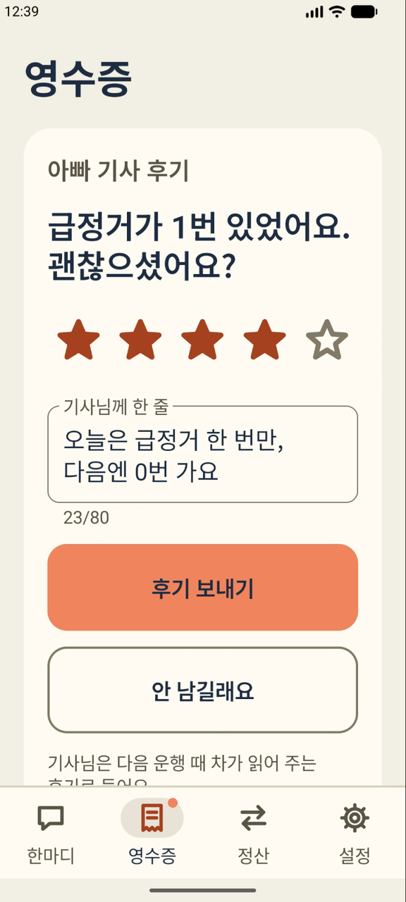

# FAXI

가족을 태우고 다니는 사람이 차 안에서 하는 일은 어디에도 남지 않습니다. 그 수고를 택시 요금처럼 숫자로 매겨 보는 놀이를 앱으로 만들었습니다. 운전하는 사람이 기사, 옆에 탄 가족이 손님이 됩니다. 요금은 차에서 읽은 값으로 1원까지 계산하고, 실제로 돈이 오가지는 않습니다. 누가 누구에게 얼마를 갚아야 하는지 가족 장부에 적어 둘 뿐입니다.

현대자동차그룹 Pleos Connect 앱 개발 공모전에 내려고 만들었습니다. 차 화면에서 도는 앱과 가족들 폰에 까는 앱, 두 개로 되어 있습니다.

## 시연 영상

[](https://github.com/saejinpark/FAXI/releases/download/v1.1/FAXI-demo.mp4)

Pleos Connect 에뮬레이터(왼쪽)와 폰 에뮬레이터(오른쪽)를 같이 녹화했습니다. 차량 값은 에뮬레이터의 Virtual Console로 넣었고, 화면에 나오는 요금은 녹화하면서 실제로 계산된 값입니다. 화면 녹화에는 소리가 담기지 않아서, 차가 그때 읽은 문장을 맥 음성으로 다시 입혔습니다.

## 어떻게 쓰나

1. 처음 켜면 이 집의 가장을 첫 기사로 등록하고, 가족은 기사 탭에서 한 사람씩 더합니다. 더할 때 그 사람이 손님일 때 바라는 것(운전 스타일, 실내 온도, 대화, 음악)을 골라 두면 탈 때 기사 화면에 뜹니다. 폰은 없어도 됩니다. 폰을 연결하면 한마디, 기사 후기, 영수증 보관을 더 쓸 수 있습니다.
2. 오늘 운전하는 사람을 기사로 고릅니다. 차가 기억해서 운전하는 사람이 바뀔 때만 다시 고릅니다. 고르면 그 기사가 아직 못 들은 손님 후기를 차가 읽어 줍니다.
3. 탈 때마다 손님을 고르고, 옆자리 손님이 차 화면의 "제가 탈게요"를 누르면 미터기가 켜집니다. 설정에서 손님 폰 코드로 확인하게 바꿀 수도 있습니다. 손님에게 밀린 돈이 있으면 차가 먼저 말로 독촉합니다.
4. 달리는 동안 차 화면에는 "엄마 손님 모시는 중"과 붙어 있는 할증, 경로, 기사 자격증, 손님이 폰으로 보낸 한마디, 요금이 붙는 옵션(에어컨, 엉따, 와이퍼, 창문)이 떠 있습니다. 얼마가 나왔는지는 내릴 때까지 모릅니다.
5. 기어를 P에 넣으면 하차입니다. 브레이크만 밟고 세운 채 문이 열려도 하차로 봅니다. 그때 영수증을 한 번에 보여 주고 요금을 읽어 줍니다. 손님은 영수증을 폰에 저장하고, 폰에서 별과 한 줄 후기를 직접 씁니다. 후기가 오면 차에 알림이 뜨고, 다음에 그 기사를 고를 때 차가 읽어 줍니다. 출발 전에는 "탑승 취소"로 요금 없이 내릴 수 있습니다.
6. 갚을 돈은 장부에 쌓입니다. 돈을 받은 사람이 차 화면에서 "받았어요"를 누르면 줄어들고, 생일에는 탕감도 됩니다.
7. 아이가 면허를 따면 기사 상세에서 "면허 땄어요"를 누릅니다. 정식 기사가 되고, 그동안 태워 준 평생 장부가 처음으로 공개됩니다.

| 탑승 | 운행 중 | 도착 |
| --- | --- | --- |
|  |  |  |

| 면허 따는 날 | 가족 장부 | 폰 앱 |
| --- | --- | --- |
|  |  |  |

## 요금표

서울 택시 요금을 흉내 냈고, 가족 택시라서 옵션 요금을 더했습니다.

| 항목 | 요금 | 어디서 읽나 |
| --- | --- | --- |
| 기본요금 | 4,800원 | 탑승 |
| 거리요금 | 132m마다 100원 | 주행거리계, 속도 |
| 대기요금 | 31초 서 있을 때마다 100원 | 속도 |
| 심야 할증 | 밤 10시~새벽 4시 20% | 시계 |
| 우천 할증 | 와이퍼가 도는 동안 10% | 와이퍼 |
| 냉난방 | 1분에 30원 | 공조 |
| 엉따 | 조수석 열선 1분에 20원 | 시트 |
| 창문 | 열려 있는 1분에 10원 | 창문 |
| 경유지 | 1곳 500원 | 내비 |
| 급정거 | 1번에 50원 돌려줌 | 속도 변화 |

가족끼리만 있는 할증과 할인도 있습니다. 탈 때 기사가 고르고, 손님이 "제가 탈게요"를 누르면 동의한 것으로 봅니다. 달리는 중에는 바꿀 수 없습니다.

| 항목 | 요금 | 언제 |
| --- | --- | --- |
| 지각 할증 | 이번 요금의 20% | 손님이 늦게 나와서 급하게 갈 때 |
| 짐 할증 | 500원 | 장 본 짐, 캐리어, 학원 가방 |
| 대기 부탁 | 1,000원 | "잠깐만 기다려 줘"가 길어질 때 |
| 생일·심부름 할인 | 여기까지 합의 절반 | 생일이거나 기사 심부름 가는 길 |

밀린 돈에는 이자가 붙지 않습니다. 다음에 탈 때 요금에 합쳐지고, 차가 며칠째인지 알려 줄 뿐입니다. 기사가 손님에게 갚을 돈이 있으면 이번 요금에서 먼저 빼 줍니다. 아직 운전을 못 하는 아이가 탄 요금은 청구하지 않고 평생 장부에 쌓아 둡니다.

## 쓴 SDK

- Pleos Vehicle SDK: 주행거리, 기어, 공조, 시트 열선, 와이퍼, 창문, 문
- Pleos TextToSpeech SDK: 인사, 요금 안내, 독촉, 후기 읽기. 차 안 엔진(ON_DEVICE)으로 읽어서 이름과 금액이 차 밖으로 나가지 않습니다.
- Pleos NaviHelper SDK: 출발지, 도착지, 경유지
- Android Car API: 속도, 주행 상태

## 서버가 없습니다

장부는 차 안에만 있습니다. 가족마다 비밀 열쇠가 하나씩 있고, 처음에 차 화면의 초대 QR을 폰으로 찍어 받아 갑니다. 설정에서 켜면 탑승 때 손님 폰에 뜨는 4자리를 확인하는데, 이 열쇠로 만드는 OTP라서 인터넷이 필요 없습니다. 손님 한마디와 기사 후기는 같은 Wi-Fi(차 핫스팟)에서 폰이 차로 직접 보내고, 같은 열쇠로 서명해서 다른 사람이 흉내 낼 수 없습니다. 영수증은 차 화면 QR을 찍거나, 같은 Wi-Fi에 있을 때 폰이 차에서 자기 것만 받아 옵니다.

## 실행 방법

APK는 [`apk/`](apk) 폴더에 있습니다. [릴리스 v1.1](https://github.com/saejinpark/FAXI/releases/tag/v1.1)에도 같은 파일이 있습니다.

| 파일 | 설치할 곳 |
| --- | --- |
| `박세진_FAXI_release.apk` | 차: Pleos Connect 에뮬레이터 (시스템 이미지 `pleos_car_emulator`, Android 14) |
| `박세진_FAXI-phone_release.apk` | 폰: Android 9 이상 기기나 에뮬레이터 |

1. 차 에뮬레이터에 차 APK를 설치합니다(`adb install -r <파일>`). 폰 APK는 한마디·후기·영수증을 시험할 때만 필요합니다.
2. 차 앱을 처음 켜면 우리 집 가장을 등록하는 화면이 나옵니다. 둘러보려면 "시연 가족으로 둘러보기"를 누릅니다. 아빠·엄마·지우·할머니와 지난 운행이 들어 있고, 아빠가 기사입니다.
3. 운행 탭에서 손님 "엄마"를 고르고 "제가 탈게요 · 미터기 켜기"를 누릅니다. 폰은 없어도 됩니다. 폰 앱(Android 9 이상)을 깔고 "엄마 폰으로 등록"을 누르면 한마디와 기사 후기를 시험할 수 있습니다.
4. 차량 값은 Virtual Console로 바꿉니다. `adb forward tcp:8088 tcp:8088`을 한 뒤 브라우저에서 `http://127.0.0.1:8088/`을 엽니다. 기어를 D로 두고 ACCEL로 달리다가 P에 넣으면 하차합니다. BRAKE로 세운 채 Door Position에서 문을 열어도 하차합니다. 에어컨, 시트 열선, 와이퍼, 창문 카드를 켜면 요금이 붙습니다.
5. 폰에서 차로 한마디나 기사 후기를 보내려면 차 에뮬레이터에 `adb forward tcp:47800 tcp:47800`을 해 둡니다. 폰 에뮬레이터는 `10.0.2.2`로 차를 찾습니다.
6. 폰 앱은 위 포트로 차와 이어지면 내린 뒤 영수증을 저절로 받아 옵니다. 에뮬레이터 카메라로는 차 화면 QR을 찍을 수 없어서, QR로 시험하려면 하차 뒤 `adb logcat -s FaxiReceipt`에 찍힌 `faxi://receipt…` 링크를 폰에서 엽니다.
   `adb shell am start -a android.intent.action.VIEW -d '<링크>' com.geppetto.faxi.phone`

`tools/demo.sh`는 에뮬레이터 두 대를 찾아 위 준비를 한 번에 합니다.

## 빌드

```bash
./gradlew assembleRelease
./gradlew testDebugUnitTest
```

`tools/package.sh`는 테스트를 돌린 뒤 `apk/` 폴더의 두 파일을 새로 만듭니다. 시험한 환경은 macOS의 Android Studio, Pleos Connect 에뮬레이터(API 34), 폰 에뮬레이터(API 37)입니다.

| 모듈 | 내용 |
| --- | --- |
| `app` | 차 앱 |
| `phone` | 폰 앱 |
| `core` | 두 앱이 같이 쓰는 요금 계산, QR, 메시지 서명, (설정에서 켜는) 탑승 코드 |
| `design` | 색, 글자, 버튼, 아이콘 |

## 아직 확인 못 한 것

- 실제 차에서는 아직 못 돌려 봤습니다. 에뮬레이터에서만 확인했습니다.
- 폰 카메라로 차 화면 QR을 찍는 것은 실기기로 해 보지 못했습니다(에뮬레이터 카메라로는 차 화면을 찍을 수 없어서 딥 링크로 시험했습니다).
- 차 핫스팟에 붙은 실제 폰이 차로 메시지를 보낼 수 있는지 아직 모릅니다.
- 창문이 열린 정도는 에뮬레이터가 주는 0~10 눈금에 맞췄습니다. 실제 차가 0~100으로 주면 그대로 읽도록 해 두었지만 확인하지 못했습니다.
